[English](README.md)

# Anthracite

**回路図**
- Webブラウザで見る（KiCanvas）：[top](https://kicanvas.org/?repo=https%3A%2F%2Fgithub.com%2Ftrope-oshw%2Fanthracite%2Ftree%2Fmain%2Fhardware%2Ftop)、[bottom](https://kicanvas.org/?repo=https%3A%2F%2Fgithub.com%2Ftrope-oshw%2Fanthracite%2Ftree%2Fmain%2Fhardware%2Fbottom)、[フットスイッチ](https://kicanvas.org/?repo=https%3A%2F%2Fgithub.com%2Ftrope-oshw%2Fanthracite%2Ftree%2Fmain%2Fhardware%2Ffootswitch)
- PNG or PDF：[`docs/schematics`](https://github.com/trope-oshw/anthracite/tree/main/docs/schematics)
- KiCad：[`hardware`](https://github.com/trope-oshw/anthracite/tree/main/hardware)

Anthracite（アンスラサイト）はMIDIで制御できるアナログ・ファズペダルです。

ビンテージ系ファズの持つボリューム追従性にフォーカスし、既存のファズペダルの扱いにくい部分を解決するために開発しました。

例えば、接続するギターの特性に合わせて入力インピーダンスを調整できるほか、ループスイッチャーを使わずともオンオフを制御するためにMIDIを採用しています。ワウペダルを使ってもワウの効果が失われることはありません。制御はデジタルで行いますが、信号経路は全てアナログで構成しています。

[Trope](https://trope-oshw.org)が設計・製造しました。

完成品は[trope-oshw.org/anthracite](https://trope-oshw.org/anthracite/)で販売しております。

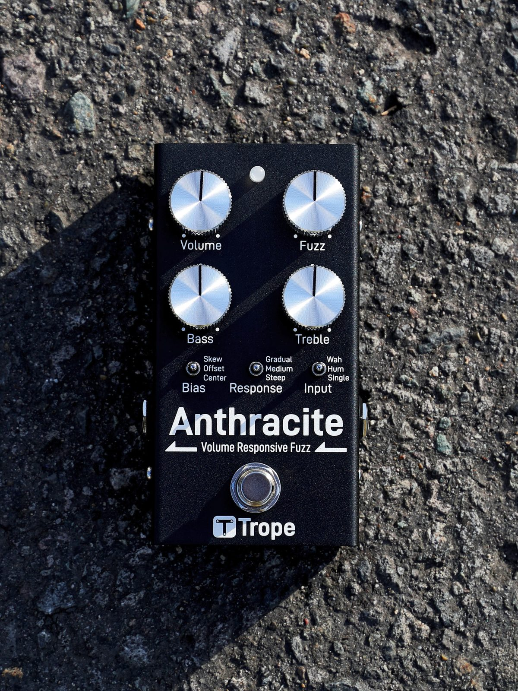

<table>
  <tr>
    <td align="center">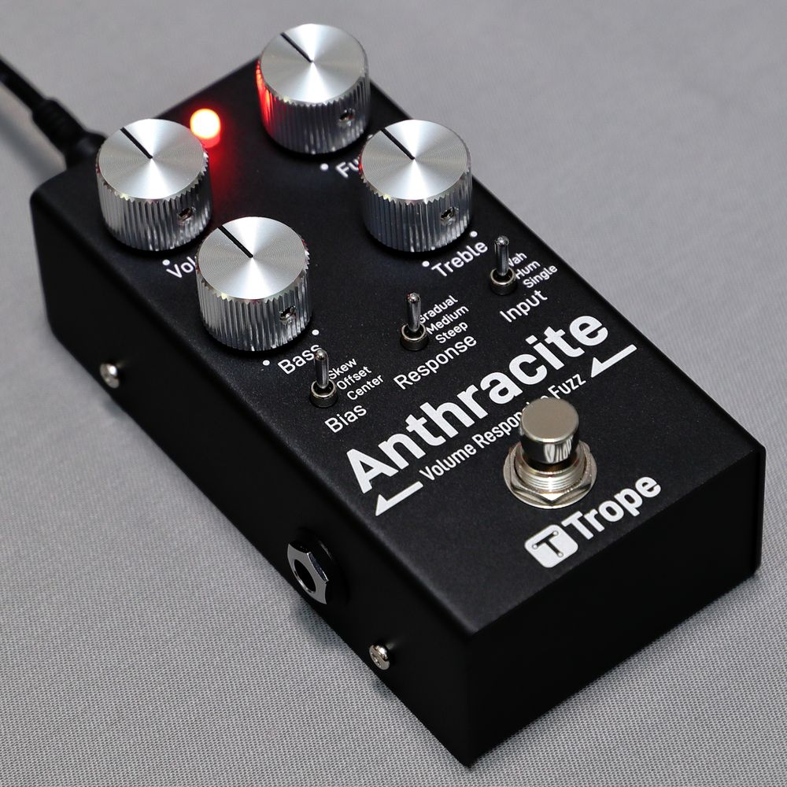</td>
    <td align="center">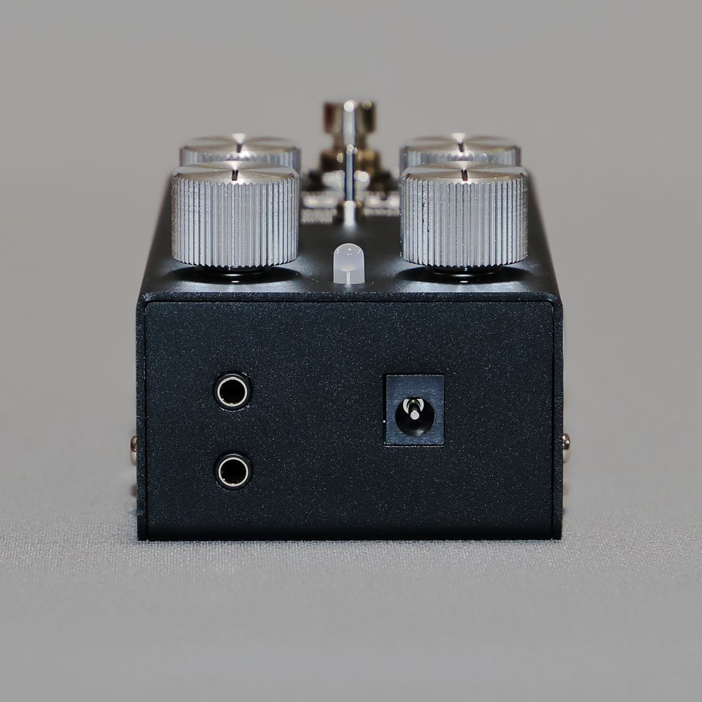</td>
    <td align="center">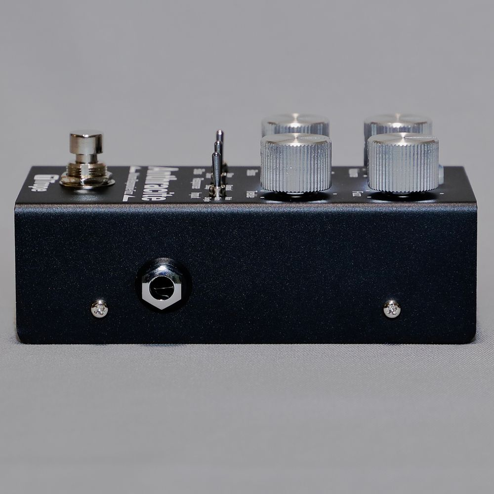</td>
  </tr>
  <tr>
    <td align="center">斜め上から、LED 点灯</td>
    <td align="center">上端：MIDI IN / OUT（3.5 mm TRS）と 9 V DC</td>
    <td align="center">入力側：1/4" ジャック</td>
  </tr>
</table>
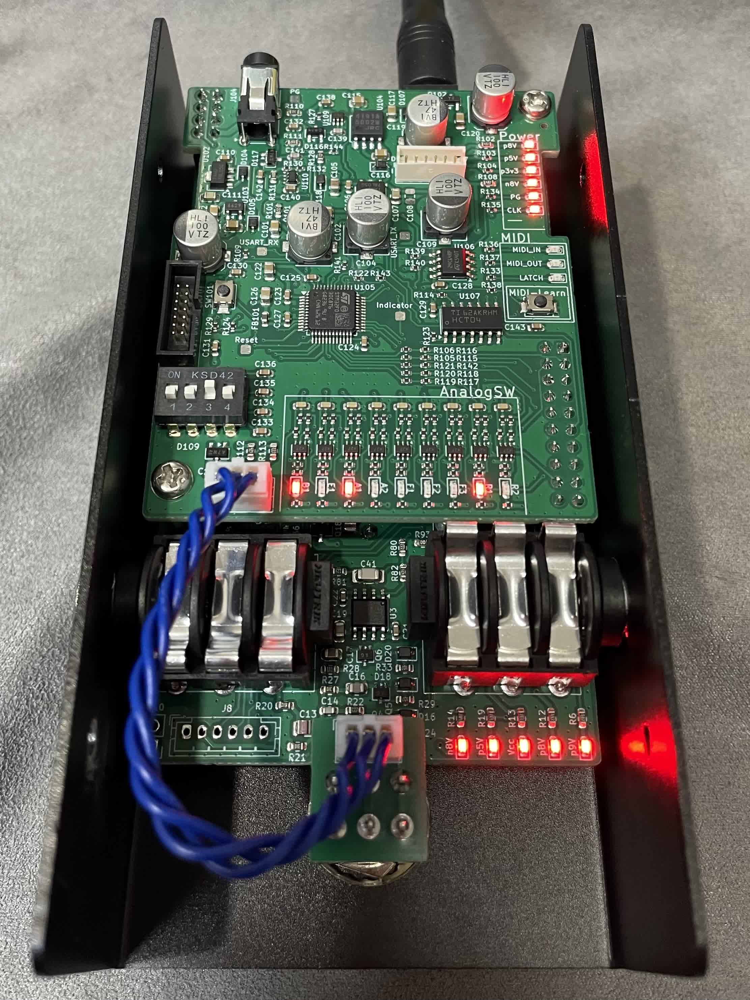

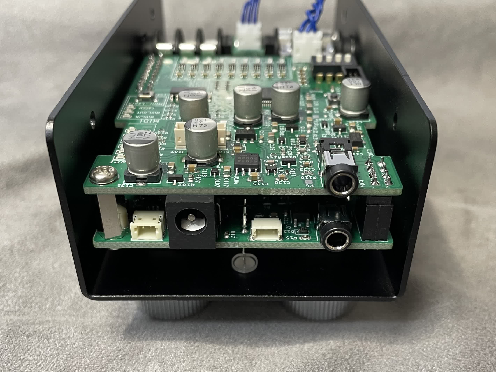

裏蓋を外した内部（v1.1）

## このリポジトリの中身

- `hardware`：KiCadのファイル
- `firmware`：Anthraciteを制御するためのSTM32マイコン用のソースコード
- `enclosure`：STEPデータ。レーザーマーキング用のDXFも含むが、Anthracite表記とTropeブランドロゴは削除しています。
- `docs`：回路図のPDFとPNG、BOMなどを含みます。

取扱説明書、測定データ、回路の解説は **https://docs.trope-oshw.org** で公開しており、主要なデータを除き、本リポジトリには重複して掲載していません。

## どんな音か

ギターはあまり上手くありませんが、参考にはなると思います。ギターのボリュームを10と6に切り替えながら弾いています。
アンプには[UAFX Dream '65](https://www.uaudio.com/products/dream-65-reverb-amplifier)を、ギターはJ.W. BlackのSTタイプを使っています。

Anthraciteはプリアンプを歪ませて使うべきです。多くの場合において、後段にオーバードライブやディストーションを使ったとしても良い結果は得られないかもしれません。

## 回路図

### Top基板

アナログ回路全てと電源の保護回路、MIDI入力とメインLEDの回路を含みます。

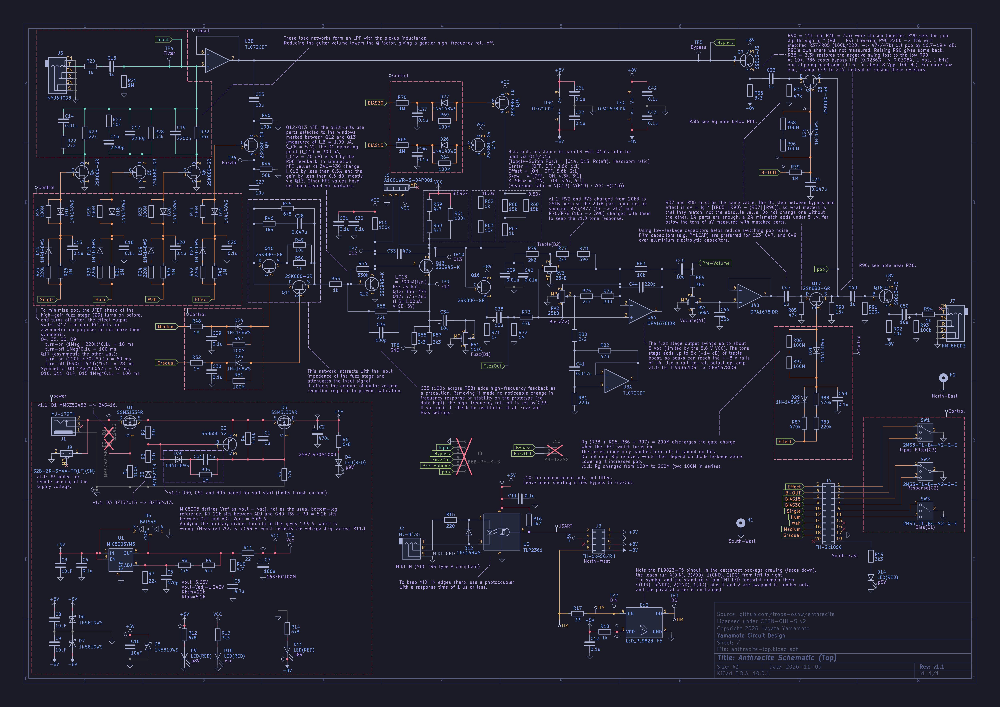

### Bottom基板

Top基板にない全て、具体的にはMCUや周辺回路、リプル除去・負電圧生成回路、リニアレギュレータ回路やMIDI出力回路などを含みます。

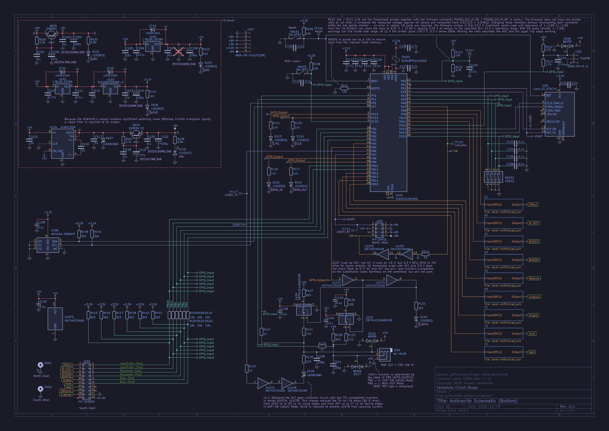

上記の回路図の階層内は以下のような回路です。アナログスイッチ制御用の信号を0~3.3V→-8~+8Vにレベル変換するシンプルな構成です。

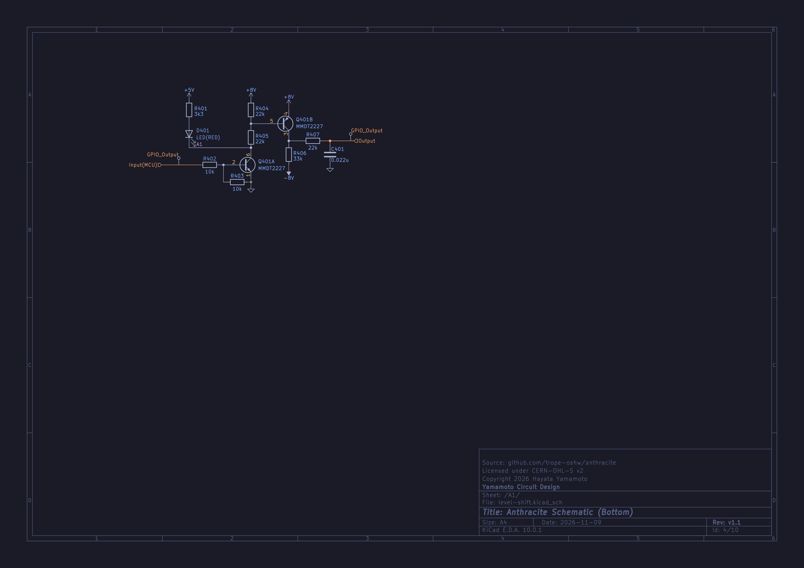

## 仕様

|                  |                                                                             |
| ---------------- | --------------------------------------------------------------------------- |
| 電源               | 9 V DC、センターマイナス、5.5 / 2.1 mm バレル。電池駆動には非対応                                |
| 推奨動作電圧           | 8.6 – 10.0 V                                                                |
| 消費電流             | エフェクトオン、9 V で約 **70 mA**                                                    |
| アダプタ定格           | 200 mA 以上必須。500 mA推奨                                                        |
| 入力インピーダンス        | エフェクトオン、1 kHz で約 **13 kΩ**（Single）/ **24 kΩ**（Hum）/ **44 kΩ**（Wah）          |
| 入力インピーダンス（バイパス時） | 100 Hz から 1 kHz で約 **1 MΩ**                                                 |
| 出力インピーダンス        | 1 kHz で約 **1 kΩ**                                                           |
| バイパス             | バッファードバイパス。アナログスイッチによる電子式切替                                                |
| MIDI             | 3.5 mm TRS、MIDI Type-A、31250 baud。MIDI IN と、外部スイッチ入力を兼ねる MIDI OUT（Thru）ジャック |
| マイコン             | STM32F030C8T6（Cortex-M0、48 MHz、LQFP48）                                      |
| 筐体               | 73.5（W）× 57.5（H）× 128（D）mm（ノブとジャックを含む）、268 g                                |

### 基板

| 基板 | サイズ | 層数 | 銅箔厚 |
|---|---|---|---|
| Top基板（アナログ） | 60 × 102 mm | 4 | 外層 35 µm（1 oz）、内層 17.5 µm（0.5 oz） |
| Bottom基板（制御） | 60 × 73.5 mm | 4 | 外層 35 µm（1 oz）、内層 17.5 µm（0.5 oz） |
| フットスイッチ基板 | 14 × 16.15 mm | 2 | - |

基板はすべて厚さ 1.6 mm の FR-4 です。

## コントロール

ポテンショメータ4個と、3ポジションのトグルスイッチ3個を備えています。

### Volume

単なるボリュームで、特に周波数特性や歪みに影響はありません。

### Fuzz

Fuzz回路の利得が変化します。小信号利得を以下に示します（Bias: Center、Response: Gradual）。

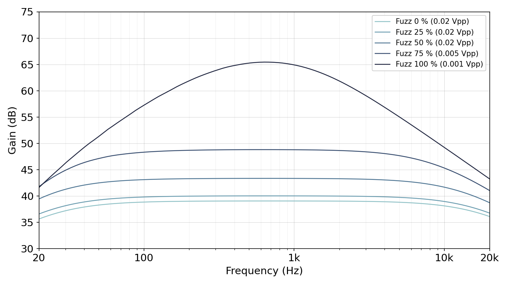

### Bass

カット側とブースト側で特性が異なるシェルビングイコライザーです。ブースト側に比べ、カット側の帯域幅が広くなるように設計しています。

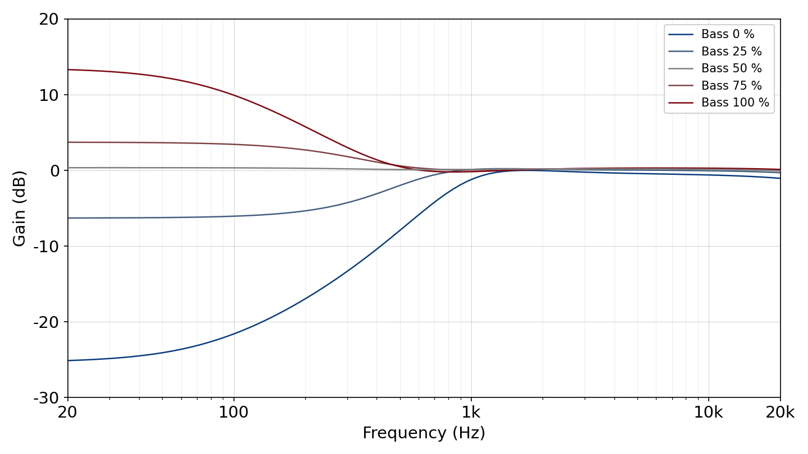

### Treble

Bassと同様の特性です。

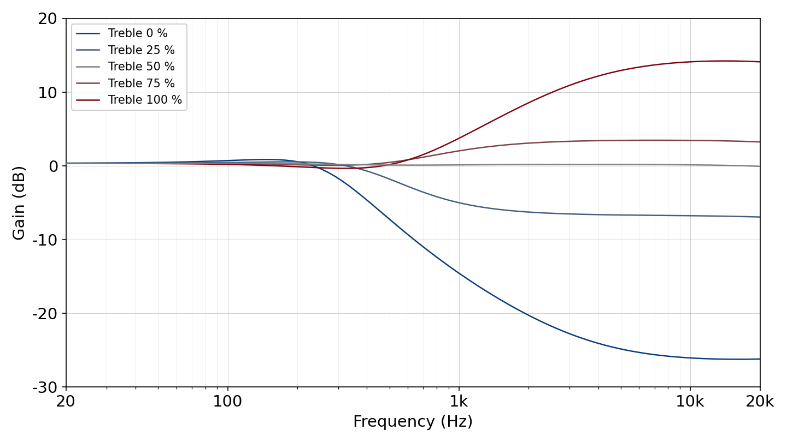

### Bias

ファズ回路の後段トランジスタの動作点比率を変更します。動作点比率はCenter（1:1）、Offset（2:1）、Skew（3:1）、X-Skew（4:1）の4種類で、X-SkewはMIDI経由等で指定することができます。
（400 Hz、Fuzz 50%、入力 約0.1 Vpp、Response: Gradual）

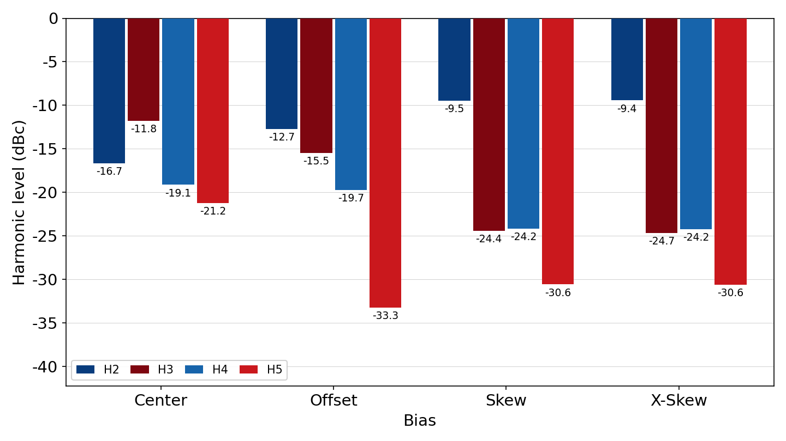

### Response

Steepは利得を低く、ハイ上がりな特性にしています。これにより、カッティングやクリーントーンのプレイスタイルに合ったサウンドが得られます。一方Gradualでは利得が高く、ボリューム追従性が控えめなため、オーバードライブ主体のサウンドに適しています。
（Fuzz 50%、Bias: Center）

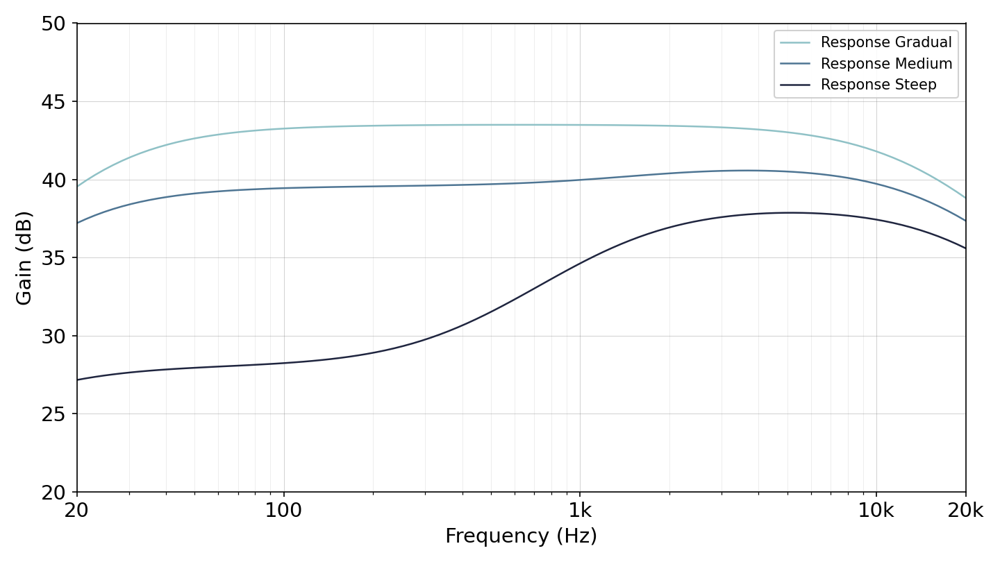

### Input

それぞれの入力ソースに合った入力インピーダンスを得ることができます。ビンテージ系ファズ特有のギター側ボリューム追従性をシングルコイル・ハムバッカーの両方で利用することができます。また、ワウとの相性問題を解決するため専用のモードを用意しています。

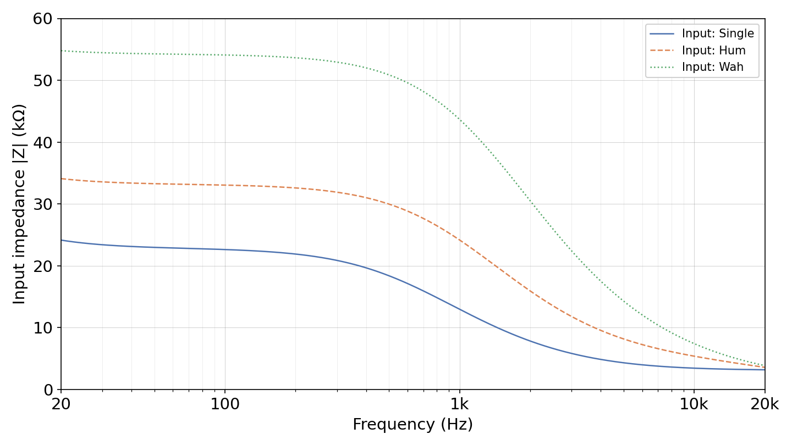

## MIDI

MIDI IN で受信した Control Change（CC）で、エフェクトのオンオフと各トグルのモードを切り替えることができます。出荷時の設定では CH12 で受信します。

|   CH   |   CC    |     機能     | Value: 0 | 1 ~ 31 | 32 ~ 63 |  64 ~ 95  |  96 ~ 127   |
| :----: | :-----: | :--------: | :------: | :----: | :-----: | :-------: | :---------: |
| **12** | **#81** | **Effect** |  Bypass  | Bypass | Bypass  | Effect On |  Effect On  |
| **12** | **#83** |   Input    |  復帰（1）  | Single |   Hum   |    Wah    | All-OFF（2） |
| **12** | **#84** |  Response  |  復帰（1）  | Steep  | Medium  |  Gradual  | (No Assign) |
| **12** | **#85** |    Bias    |  復帰（1）  | Center | Offset  |   Skew    |   X-Skew    |

（1）トグルスイッチの位置どおりのモードに復帰します。パネルのトグルを操作しても同じようにトグルスイッチの位置ベースのモードとなります（原則後から操作した方が有効となります）。

（2）エフェクトオン時も入力フィルタが適用されず、入力はバイパス時と同等の高インピーダンスとなります。前段にバッファがある場合などにご利用ください。

MIDI-Learn を使用すると、CH と Effect の CC を変更することができます。

詳細は[取扱説明書](https://docs.trope-oshw.org/Anthracite/)と[ファームウェア](https://github.com/trope-oshw/anthracite/tree/main/firmware)をご参照ください。

## 基板の製作

KiCad プロジェクトには KiCad 10 以降が必要になります。プロジェクトは自己完結しており、独自のシンボルとフットプリントはすべてプロジェクト内の `libs/` ディレクトリに収録しています。本リポジトリをクローンすれば、追加のライブラリを導入せずにプロジェクトを開くことができます。

[`hardware/parts.md`](hardware/parts.md) には、各基板に選定した部品をメーカー型番および LCSC 番号とともに記載しています。

量産時の発注パラメータは、各リリースに添付した `ordering-notes.md` に記録していますのでこちらをご参照ください。

## ファームウェア

ソースコード一式は [`firmware/`](firmware/) に収録しています。[firmware/README.md](firmware/README.md) の手順でビルドすると、出荷品に書き込まれているイメージとバイト単位で一致するイメージが得られます。同ファイルには、ツールチェーンのバージョン、イメージの SHA-256、完成品への書き込み方法を記載しています。

ペダルを使用するだけであれば、ファームウェアを書き換える必要はありません。所有するハードウェアのソフトウェアを自ら差し替えられることは本ライセンスの目的の一つであり、そのために書き込み手順を掲載しています。

ファームウェア 1.1.0 は v1.1 基板専用、1.0.0 は v1.0 基板専用であり、互換性は保証しておりません。

## ライセンス

| 対象 | ライセンス |
|---|---|
| ハードウェア（`hardware/`、`enclosure/`） | **CERN-OHL-S-2.0** |
| KiCad標準ライブラリに由来するシンボルとフットプリント（`hardware/*/libs/`。対象は`REUSE.toml`に列挙） | **CC-BY-SA-4.0 WITH KiCad-libraries-exception**（シンボルライブラリにはCERN-OHL-S-2.0も適用） |
| ファームウェア（`firmware/`）。サードパーティ製コードを除く | **GPL-3.0-or-later** |
| 生成した設計ドキュメント（`docs/`：回路図、部品表、基板の 3D） | **CERN-OHL-S-2.0** |
| 製品写真と測定グラフ（`docs/images/`） | **CC-BY-SA-4.0** |
| 文章（この README、CHANGELOG、ERRATA、CONTRIBUTING、TRADEMARK） | **CC-BY-SA-4.0** |

ライセンスの全文は [`LICENSES/`](LICENSES/) に収録しており、ファイルごとの割り当ては [REUSE](https://reuse.software/) 仕様に従って [`REUSE.toml`](REUSE.toml) で宣言しています。著作権表示は [`COPYRIGHT.txt`](COPYRIGHT.txt) に記載しております。

STMicroelectronics および Arm のコードと、KiCad 標準ライブラリに由来するシンボルおよびフットプリントには、元のライセンスが適用されます。対象のファイルは `REUSE.toml` に列挙しております。

## 商標

設計ファイルはオープンソースとして公開しておりますが、Trope、山本回路設計、Anthracite の名称および Trope のロゴは商標であり、上記ライセンスの対象外となります。派生品の製作と販売は自由に行っていただけますが、派生品には独自の名称をご使用ください。「Trope による Anthracite の設計に基づく」と表示していただくことは差し支えありません。なお、公開ファイルにはブランド表示を含めておりません。

詳細は [TRADEMARK.ja.md](TRADEMARK.ja.md) をご参照ください。ご質問および商標使用のご依頼は trope.oshw@gmail.com にて受け付けております。事前に相談があれば大抵の場合は許可するでしょう。

## バージョン

製品と基板には `vMAJOR.MINOR` 形式の番号を付与し、基板のシルクスクリーンに印字しております。ファームウェアにはこれとは独立したセマンティックバージョンを付与しており、両者は連動しておりません。ファームウェアの不具合を修正しても基板は変わらないため、基板バージョンは据え置きとなります。

各リリースの変更点は [CHANGELOG.md](CHANGELOG.md) に、製作済みのハードウェアで判明した問題は [ERRATA.md](ERRATA.md) に記載しております。**お手元の個体の動作が本書の記載と異なる場合は、最初に ERRATA.md をご確認ください**。

## 購入

Anthracite は現在販売しております。Trope が1台ずつ製作と検査を行い、個体ごとの検査成績書を添えて出荷いたします。現在の価格は製品ページ **https://trope-oshw.org/anthracite/** に掲載しており、ご注文も同ページにて受け付けております。原価の内訳と価格の算定式は **https://docs.trope-oshw.org** で公開しています。発送は国内のみとなっております。ご質問は trope.oshw@gmail.com までご連絡ください。

## コントリビューション

Issue、およびファームウェアとドキュメントへのプルリクエストを歓迎いたします。ハードウェアへのプルリクエストは原則お受けしておりません。理由は [CONTRIBUTING.ja.md](CONTRIBUTING.ja.md) をご参照ください。

## 免責事項

本設計は、商品性および特定目的への適合性を含め、明示・黙示を問わず **いかなる保証もなく現状のまま** 配布するものです。免責条項の全文は CERN-OHL-S v2 の第 6.1 節および第 6.2 節をご参照ください。

本リポジトリのファイルに基づいてハードウェアを製作、改変、販売する場合、**その製作者が当該ハードウェアの製造者となります**。安全性、および販売する地域で適用されるすべての規制への適合については、製作者が単独で責任を負うものとします。山本回路設計が取得した認証、試験結果、適合マークは **山本回路設計が製作・販売した個体にのみ** 適用されるものであり、第三者が製作したハードウェアには適用されません。

電源には、安定化された極性の正しい 9 V DC をご使用ください。不適切な電源を使用すると、本機および接続した機器が損傷するおそれがあります。
