[日本語](README.ja.md)

# Anthracite

**Schematics**
- In the browser (KiCanvas): [top](https://kicanvas.org/?repo=https%3A%2F%2Fgithub.com%2Ftrope-oshw%2Fanthracite%2Ftree%2Fmain%2Fhardware%2Ftop), [bottom](https://kicanvas.org/?repo=https%3A%2F%2Fgithub.com%2Ftrope-oshw%2Fanthracite%2Ftree%2Fmain%2Fhardware%2Fbottom), [footswitch](https://kicanvas.org/?repo=https%3A%2F%2Fgithub.com%2Ftrope-oshw%2Fanthracite%2Ftree%2Fmain%2Fhardware%2Ffootswitch)
- PNG or PDF: [`docs/schematics`](https://github.com/trope-oshw/anthracite/tree/main/docs/schematics)
- KiCad: [`hardware`](https://github.com/trope-oshw/anthracite/tree/main/hardware)

Anthracite is a MIDI-controllable analogue fuzz pedal.

It was built around the way a vintage fuzz follows the guitar's volume knob,
and to fix the parts of a fuzz pedal that are awkward to live with.

For example, you can adjust the input impedance to suit the guitar you plug in,
and MIDI control switches the pedal on and off without a loop switcher. A wah
in front of it keeps its effect. Control is digital, but the signal path is
analogue throughout.

Designed and built by [Trope](https://trope-oshw.org).
Finished, tested units are sold at [trope-oshw.org/anthracite](https://trope-oshw.org/anthracite/).

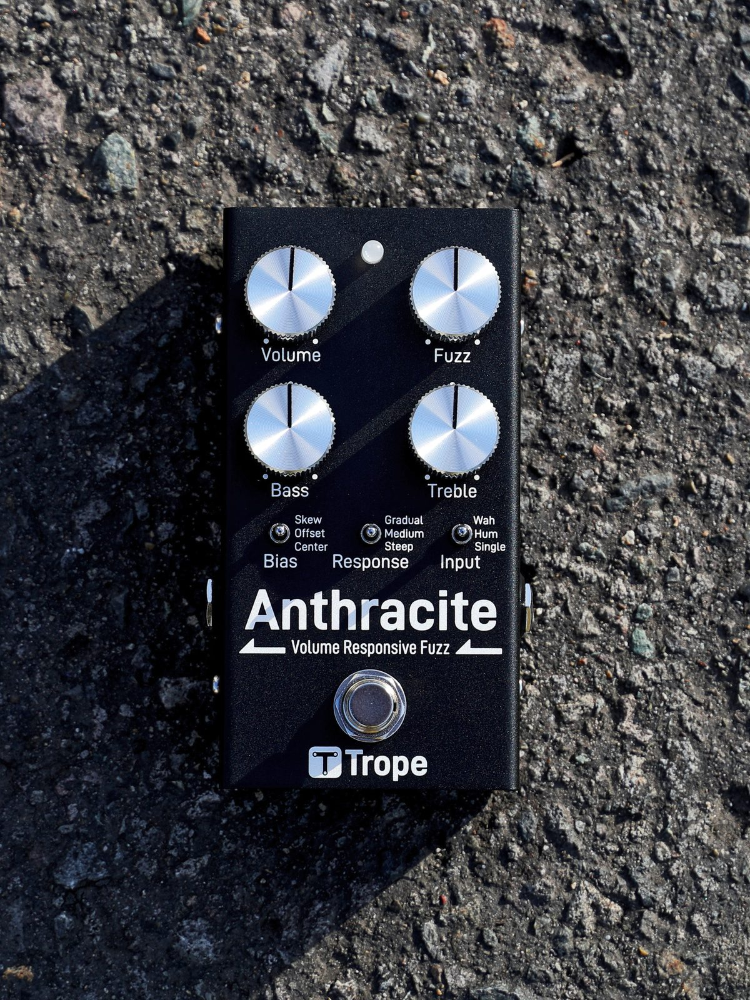

<table>
  <tr>
    <td align="center">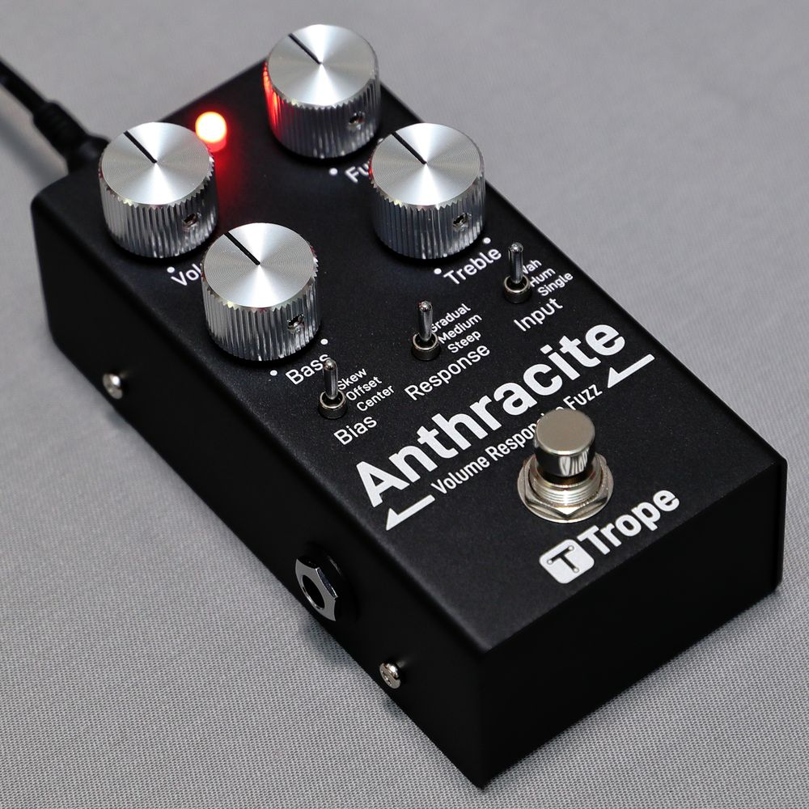</td>
    <td align="center">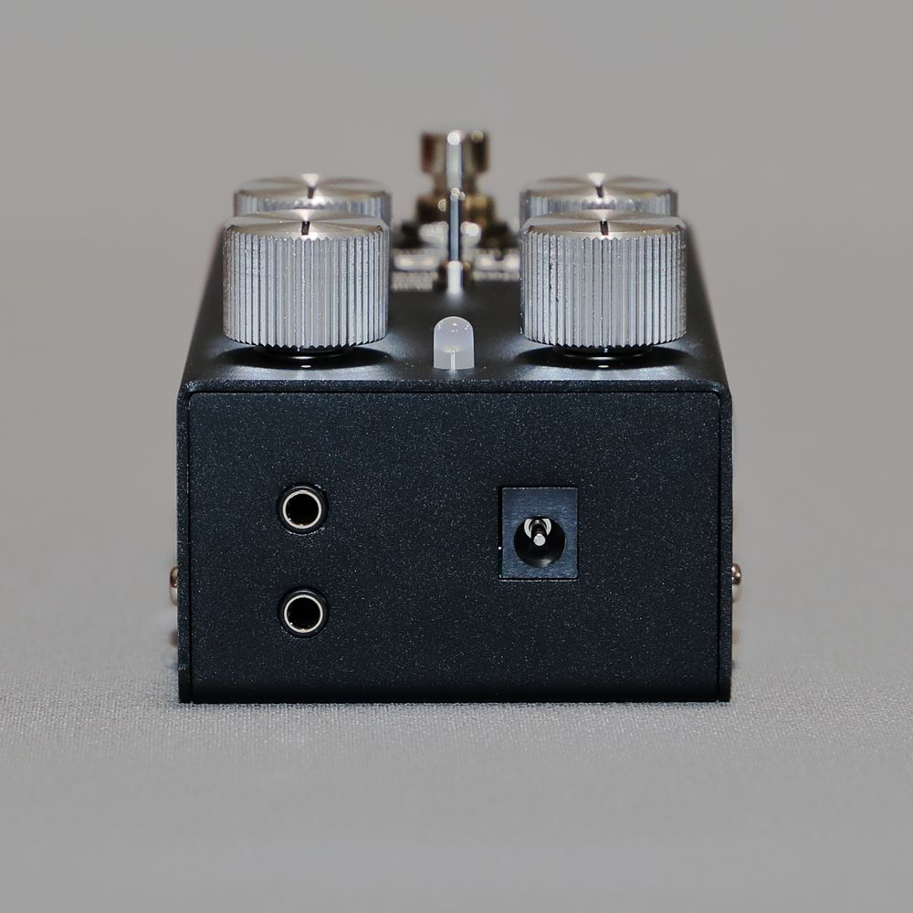</td>
    <td align="center">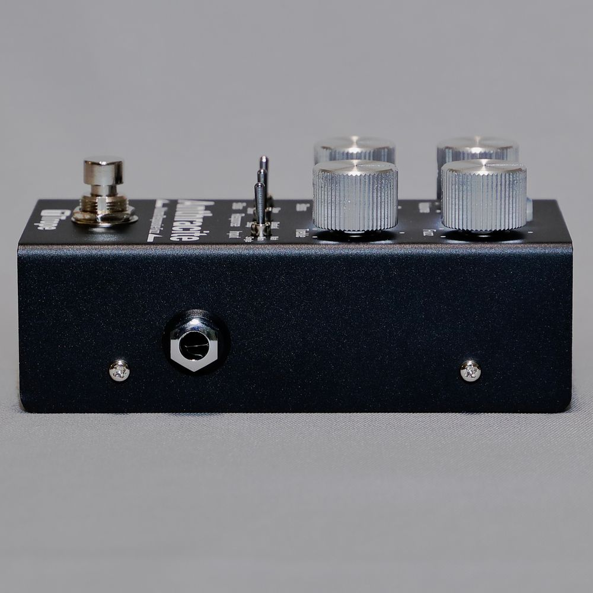</td>
  </tr>
  <tr>
    <td align="center">Angled view, LED lit</td>
    <td align="center">Top edge: MIDI IN / OUT (3.5 mm TRS) and 9 V DC</td>
    <td align="center">Input side: 1/4" jack</td>
  </tr>
</table>

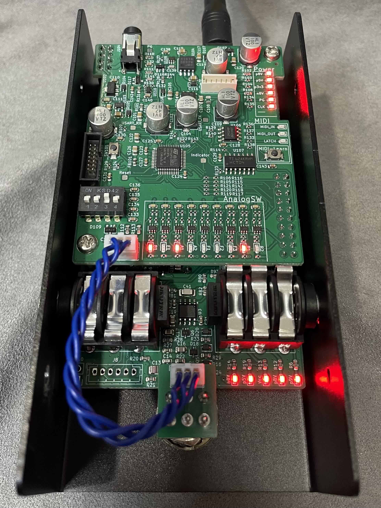

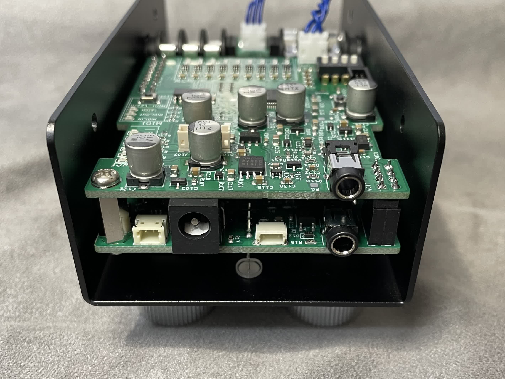

Inside, with the back cover removed (v1.1)

## So what's in here:

- `hardware` has the KiCad files.
- `firmware` has the source code for the STM32 microcontroller that controls
  Anthracite.
- `enclosure` has the STEP data. The DXF for laser marking is in there too,
  with the Anthracite name and the Trope logo removed.
- `docs` has the schematics as PDF and PNG, the BOMs and so on.

The user manual, measured data and circuit explanations are published at
**https://docs.trope-oshw.org**. Apart from the main data, they are not
duplicated here.

## What kind of sound is this:

I'm not very good at playing the guitar, but this might be helpful. I switch
the guitar's volume between 10 and 6 as I play. The amp is a
[UAFX Dream '65](https://www.uaudio.com/products/dream-65-reverb-amplifier)
and the guitar is a J.W. Black S-style.

Anthracite should be played into a preamp that is already overdriven. In most
cases, putting an overdrive or distortion pedal after it may not give good
results.

## Schematics

### Top board

All of the analogue circuitry, the power-input protection, the MIDI input and
the main LED.

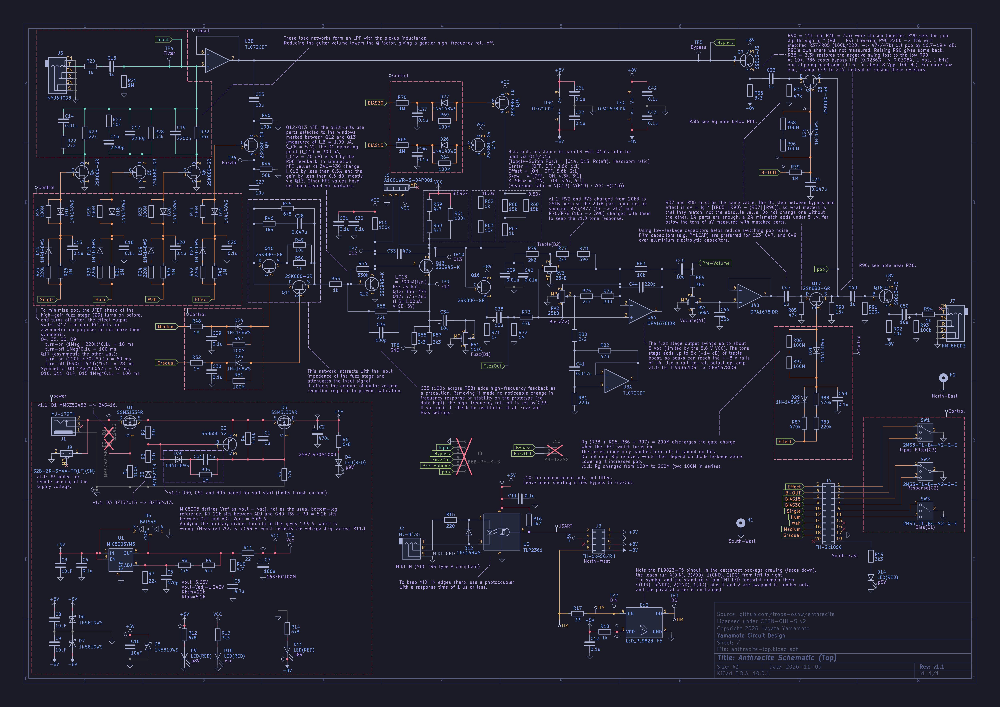

### Bottom board

Everything that is not on the top board: the MCU and its peripherals, the
ripple filter and negative-rail generator, the linear regulators, the MIDI
output and so on.

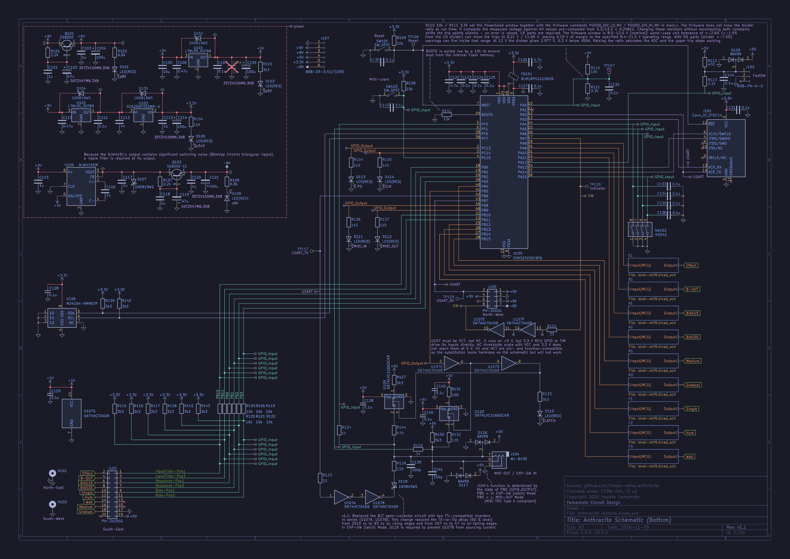

The hierarchical sheet in the schematic above contains the circuit below. It
is a simple level shifter that takes the analogue-switch control signals from
0 – 3.3 V to −8 – +8 V.

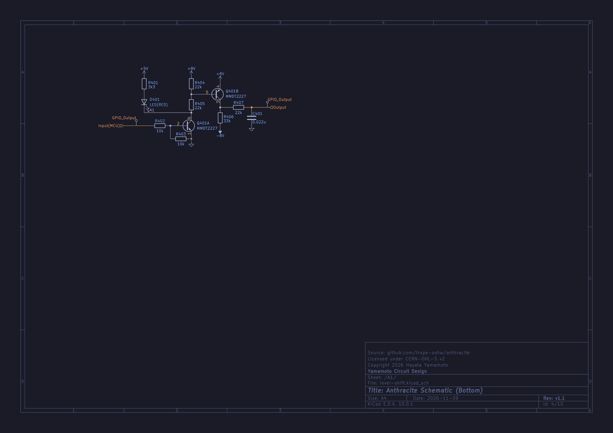

## Specifications

| | |
|---|---|
| Power | 9 V DC, centre-negative, 5.5 / 2.1 mm barrel. No battery operation |
| Recommended operating voltage | 8.6 – 10.0 V |
| Current draw | About **70 mA** at 9 V with the effect on |
| Adapter rating | 200 mA or more required; 500 mA recommended |
| Input impedance | About **13 kΩ** (Single) / **24 kΩ** (Hum) / **44 kΩ** (Wah) at 1 kHz, effect on |
| Input impedance, bypassed | About **1 MΩ** from 100 Hz to 1 kHz |
| Output impedance | About **1 kΩ** at 1 kHz |
| Bypass | Buffered. Switched by analogue switches |
| MIDI | 3.5 mm TRS, MIDI Type-A, 31250 baud. MIDI IN, and a MIDI OUT (Thru) jack that doubles as an external-switch input |
| Microcontroller | STM32F030C8T6 (Cortex-M0, 48 MHz, LQFP48) |
| Enclosure | 73.5 (W) × 57.5 (H) × 128 (D) mm including knobs and jacks, 268 g |

### Boards

| Board | Size | Layers | Copper |
|---|---|---|---|
| Top (analogue) | 60 × 102 mm | 4 | 35 µm (1 oz) outer, 17.5 µm (0.5 oz) inner |
| Bottom (control) | 60 × 73.5 mm | 4 | 35 µm (1 oz) outer, 17.5 µm (0.5 oz) inner |
| Footswitch | 14 × 16.15 mm | 2 | — |

All boards are 1.6 mm FR-4.

## Controls

Four potentiometers and three three-position toggles.

### Volume

Just a volume control. It does not affect the frequency response or the
distortion.

### Fuzz

Changes the gain of the fuzz circuit. The small-signal gain is shown below
(Bias: Center, Response: Gradual).

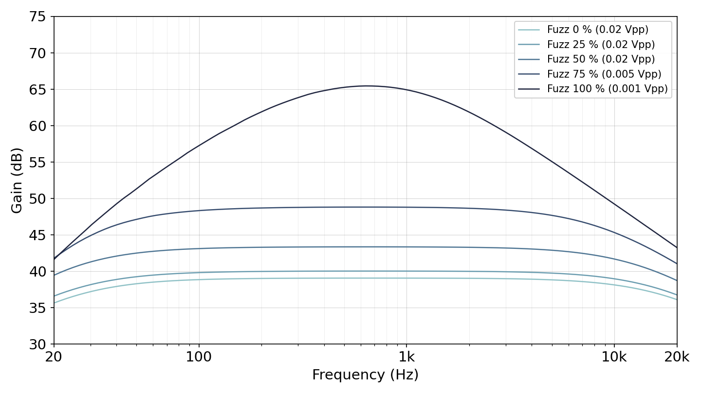

### Bass

A shelving EQ that behaves differently when cutting and when boosting: the cut
is designed to cover a wider band than the boost.

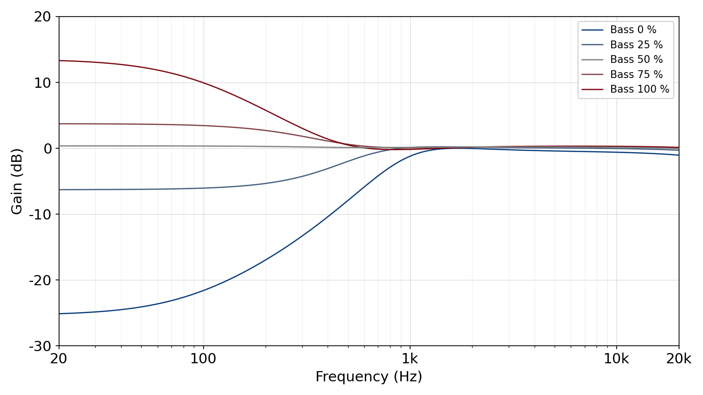

### Treble

Similar to Bass.

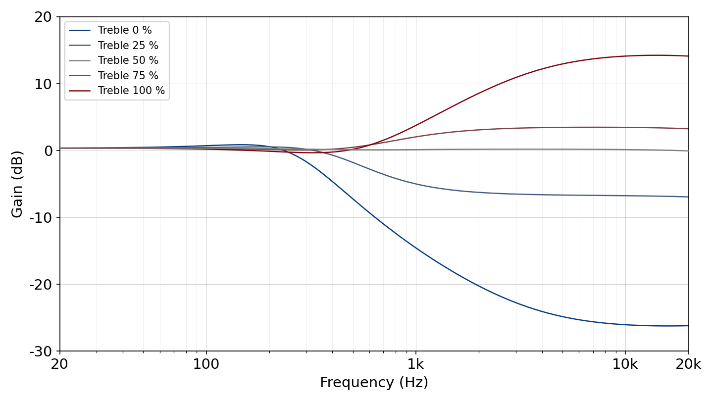

### Bias

Changes the operating-point ratio of the output-side transistor in the fuzz
circuit. There are four ratios: Center (1:1), Offset (2:1), Skew (3:1) and
X-Skew (4:1). X-Skew can be selected over MIDI, among other ways.
(400 Hz, Fuzz 50 %, about 0.1 Vpp in, Response: Gradual)

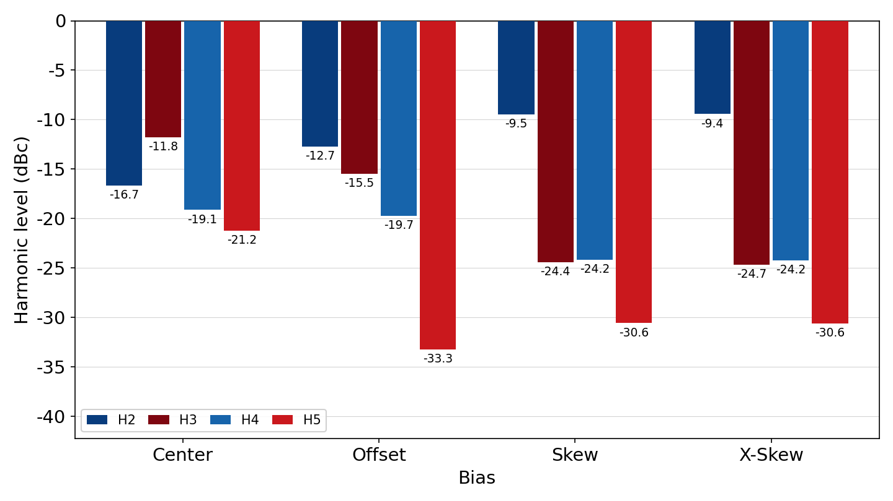

### Response

Steep lowers the gain and tilts the response towards the highs, which suits
rhythm playing and clean tones. Gradual has more gain and follows the guitar's
volume knob less closely, which suits overdrive-centred sounds.
(Fuzz 50 %, Bias: Center)

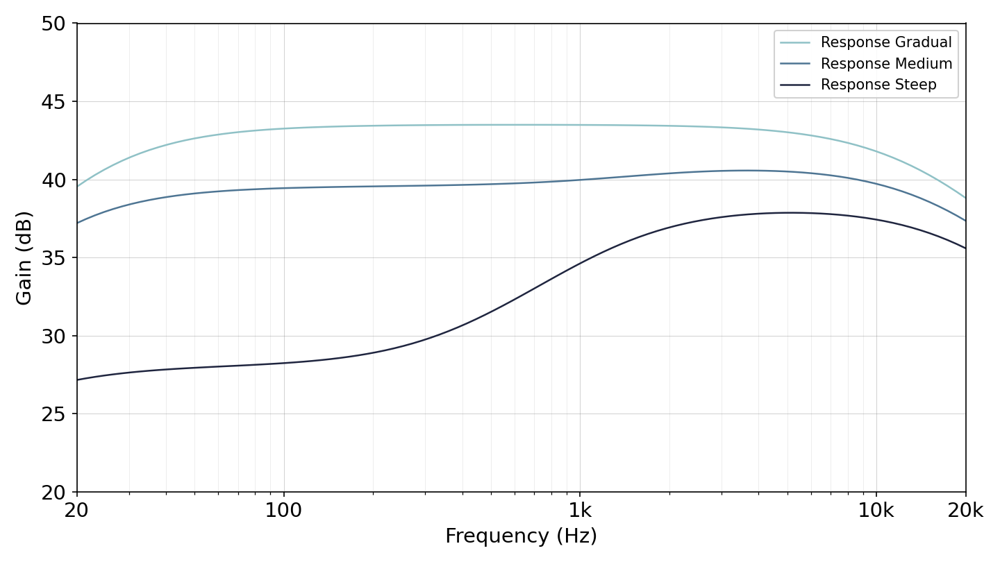

### Input

Gives each kind of source an input impedance that suits it. The way a vintage
fuzz follows the guitar's volume knob is available with both single coils and
humbuckers. There is also a dedicated mode that solves the usual trouble with
a wah.

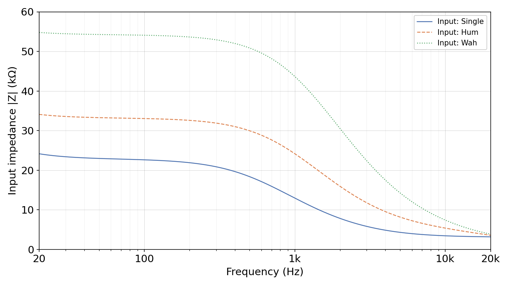

## MIDI

Control Change (CC) messages received on MIDI IN switch the effect on and off
and select the mode of each toggle. As shipped, the pedal listens on
channel 12.

| CH | CC | Function | Value: 0 | 1 – 31 | 32 – 63 | 64 – 95 | 96 – 127 |
|:---:|:---:|:---:|:---:|:---:|:---:|:---:|:---:|
| **12** | **#81** | **Effect** | Bypass | Bypass | Bypass | Effect On | Effect On |
| **12** | **#83** | Input | Return (1) | Single | Hum | Wah | All-OFF (2) |
| **12** | **#84** | Response | Return (1) | Steep | Medium | Gradual | (No Assign) |
| **12** | **#85** | Bias | Return (1) | Center | Offset | Skew | X-Skew |

(1) Returns to the mode set by the toggle position. Moving the toggle on the
panel does the same; as a rule, whichever was operated last takes effect.

(2) The input filter is not applied even with the effect on, so the input
stays at the same high impedance as in bypass. Use it when, for example, there
is a buffer in front of the pedal.

With MIDI-Learn you can change the channel and the CC used for Effect.

Details are in the [user manual](https://docs.trope-oshw.org/Anthracite/) and
the [firmware](https://github.com/trope-oshw/anthracite/tree/main/firmware).

## Building the boards

The KiCad projects need KiCad 10 or later. They are self-contained: every
custom symbol and footprint is in the project's own `libs/` directory, so you
can clone this repository and open them without installing anything else.

[`hardware/parts.md`](hardware/parts.md) lists the parts chosen for each board,
with manufacturer part numbers and LCSC numbers.

Ordering parameters used for the production run are recorded in
`ordering-notes.md` attached to each release. They matter, because a different
stackup or copper weight gives a different board.

## Firmware

The full source is in [`firmware/`](firmware/). Built as described in
[firmware/README.md](firmware/README.md), it reproduces the image on shipped
units byte for byte; that file gives the toolchain versions, the SHA-256 of the
image, and how to write it to a finished unit.

You do not need to touch the firmware to use the pedal; the instructions are
there because being able to replace the software on hardware you own is part
of what this licence is for.

Firmware 1.1.0 is for v1.1 boards only, and 1.0.0 is for v1.0 boards only.
Compatibility between them is not guaranteed.

## Licensing

| What | Licence |
|---|---|
| Hardware (`hardware/`, `enclosure/`) | **CERN-OHL-S-2.0** |
| Symbols and footprints derived from the KiCad standard libraries (`hardware/*/libs/`, listed in `REUSE.toml`) | **CC-BY-SA-4.0 WITH KiCad-libraries-exception** (the symbol libraries also CERN-OHL-S-2.0) |
| Firmware (`firmware/`), except third-party code | **GPL-3.0-or-later** |
| Generated design documents (`docs/`: schematics, bills of materials, board 3D) | **CERN-OHL-S-2.0** |
| Product photographs and measured-data plots (`docs/images/`) | **CC-BY-SA-4.0** |
| Text (this README, CHANGELOG, ERRATA, CONTRIBUTING, TRADEMARK) | **CC-BY-SA-4.0** |

Full texts are in [`LICENSES/`](LICENSES/); per-file assignments are declared in
[`REUSE.toml`](REUSE.toml) following the [REUSE](https://reuse.software/)
specification. See [`COPYRIGHT.txt`](COPYRIGHT.txt) for the notices.

Code from STMicroelectronics and Arm, and symbols and footprints derived from
the KiCad standard libraries, keep their original licences. `REUSE.toml` lists
the files.

## Trademark

The design files are open source, but the names Trope, 山本回路設計 and
Anthracite, and the Trope logo, are trademarks and are not covered by the
licences above. You are free to build and sell derivatives; please give them
your own name. You may state that your product is *based on the Anthracite
design by Trope*. The published files carry no Trope branding.

Details are in [TRADEMARK.md](TRADEMARK.md). Questions, or a request to use
the marks: trope.oshw@gmail.com. Ask first, and the answer is almost always
yes.

## Versions

The product and the boards carry a `vMAJOR.MINOR` number, silkscreened on the
PCB. The firmware carries its own semantic version. They move independently:
fixing a firmware bug does not change the boards, so the board version stays put.

See [CHANGELOG.md](CHANGELOG.md) for what changed in each release, and
[ERRATA.md](ERRATA.md) for problems found in hardware that has already been
built. **If your unit behaves differently from this documentation, check the
errata first.**

## Buying one

Anthracite is on sale. Trope builds and tests each unit and ships it with its
own test report. The product page at **https://trope-oshw.org/anthracite/**
shows the current price and takes orders. Trope publishes the cost breakdown
and the formula behind the price at **https://docs.trope-oshw.org**.
Trope ships within Japan only. Questions go to trope.oshw@gmail.com.

## Contributing

Issues are welcome. As a rule, Trope does not accept pull requests to the
hardware; [CONTRIBUTING.md](CONTRIBUTING.md) explains why. Firmware and
documentation PRs are welcome.

## Disclaimer

This design is distributed **as-is, with no warranty of any kind**, express or
implied, including merchantability and fitness for a particular purpose. See
sections 6.1 and 6.2 of the CERN-OHL-S v2 for the full disclaimer.

If you build, modify, or sell hardware based on these files, **you are the
manufacturer** of that hardware. You alone are responsible for its safety and
for its compliance with every regulation that applies where you place it on the
market. Any certification, testing, or conformity marking obtained by
山本回路設計 applies **only to units built and sold by 山本回路設計**, and does
not transfer to your build.

Use a regulated, correctly-polarised 9 V DC supply. Incorrect power can damage
the pedal and whatever is connected to it.
